# 🖥️ Gameyfin Desktop

Download, install and play your games from [Gameyfin](https://github.com/gameyfin/gameyfin) — a desktop client for Windows and Linux.

---

### ✨ What it does

* **Download** games from your Gameyfin instance, with progress and history in a Downloads tab. Archives are extracted while they download, so nothing extra is written to disk.
* **Install** them with one click. On Linux the app creates a wine prefix and launches the installer with `umu-run` (including automatic umu-id lookup for Proton fixes); on Windows it just extracts and runs the `.exe`.
* **Play** them — shortcuts are created on your desktop, in your application menu and optionally in Steam, and installed games can be launched straight from the app. Wine prefixes can be reconfigured or deleted afterwards.
* **Browse your collection like a real shelf:** the optional native library shows your games as boxes on a bookshelf.
  Hover a box and it slides out, showing its cover. Open a game and it appears as a 3D box: turn it around to read the
  back, or open it for the full details. Starting a download plays a short "disc into the drive" animation.
  Prefer something plainer? Switch to the classic cover grid and metadata page in **Settings → Library**, and change
  the shelf size there too.
* **Couch friendly:** the whole app can be driven with a gamepad, and it lives in the system tray.
* **Persistent login** (including SSO) so you only sign in once.

### 🎮 Gamepad controls

| Button             | Action                    |
|:-------------------|:--------------------------|
| D-pad / Left stick | Move between items        |
| A                  | Select / activate         |
| B                  | Back, cancel or close     |
| Y                  | Refresh / reload          |
| LB / RB            | Previous / next tab       |
| LT / RT            | Page up / page down       |
| Right stick        | Scroll                    |
| Start              | Show the controls overlay |

---

### ▶️ Install & run

#### 🐧 Linux (Flatpak, recommended)

Download the latest `Gameyfin-Desktop-vX.X.X.flatpak` from [Releases](https://github.com/mdmatthias/Gameyfin-Desktop/releases), then:

```bash
flatpak install --user Gameyfin-Desktop-vX.X.X.flatpak -y
flatpak run org.gameyfin.Gameyfin-Desktop
```

Everything (including `umu-launcher`) is bundled, and no root password is needed.

32-bit games and launchers (e.g. Battle.net) also need the 32-bit graphics drivers, which Flatpak doesn't install for a `.flatpak` bundle. The app offers to install them on first start; to do it by hand:

```bash
flatpak install --user flathub org.freedesktop.Platform.GL32.default
```

(NVIDIA users: `org.freedesktop.Platform.GL32.nvidia-<driver-version>`; see `flatpak --gl-drivers`.)

#### 🪟 Windows

Download and run the latest `Gameyfin-Desktop-vX.X.X.exe` from [Releases](https://github.com/mdmatthias/Gameyfin-Desktop/releases).

#### From source

```bash
pip install -r requirements.txt
python gameyfin_qt.py
```

On Linux you also need `umu-launcher` from your distro's repos. If you prefer distro packages for the Python
dependencies, note that `stream-unzip` and `pygame-ce` (gamepad support) aren't packaged on Arch/Fedora and have to
come from pip.

On first launch, enter the URL of your Gameyfin instance in the **Settings** tab.

---

### 📝 Notes
* The native library UI (**Settings → Library**) only lets you browse and play your Gameyfin libraries, but it's much
  more gamepad friendly. You can switch between the shelf and the classic grid, the 3D box and the classic game page,
  and set the shelf size and number of games per page.
* For the full Gameyfin website (e.g. for administration), turn the native library UI off or use the **Web view**
  button. The gamepad works there too, but it can be a bit funky.
* Data (settings, history, login session, cache) is stored in `~/.local/share/Gameyfin/Gameyfin/` on Linux and
  `%APPDATA%\Gameyfin\Gameyfin\` on Windows.
* Accurate download progress needs Gameyfin 2.4.1-preview or newer; on older servers the size is estimated.
* Ideas or bugs? Open an issue.
* Built with the help of AI — if something looks off, please let me know!

### 🖼️ Screenshots
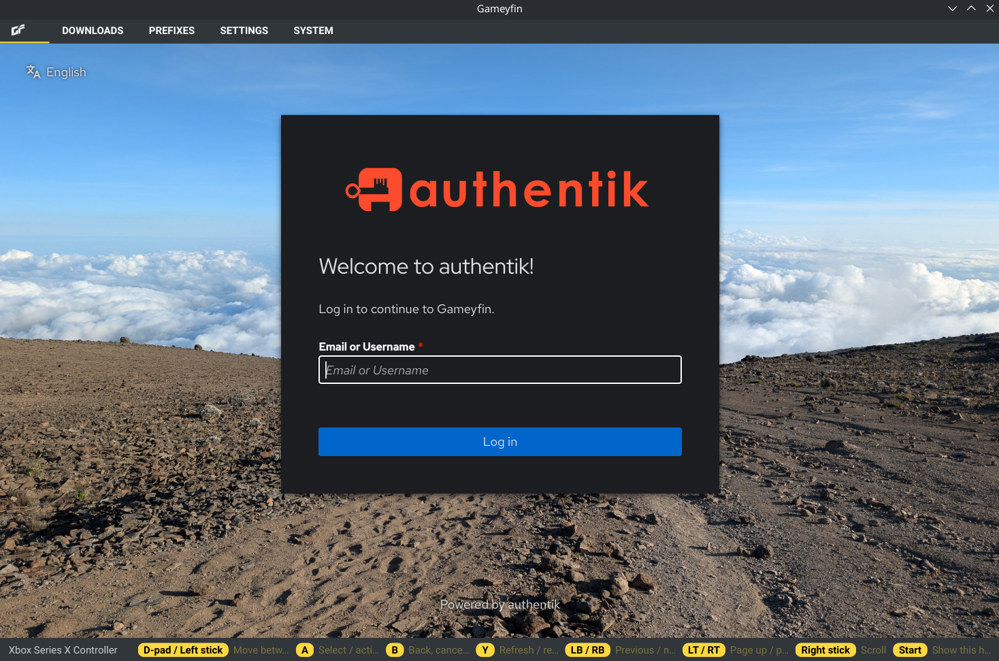
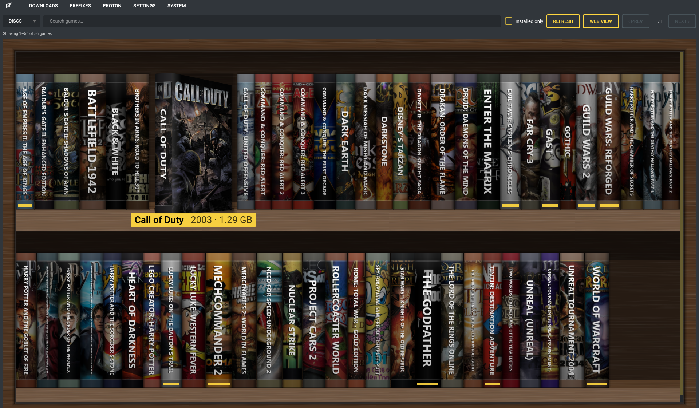
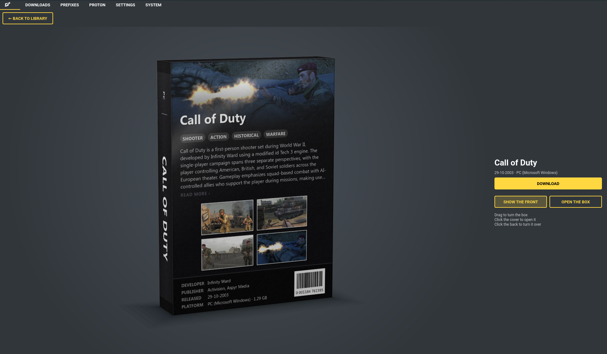
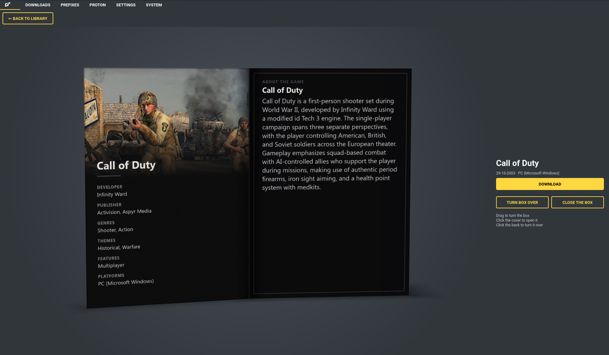
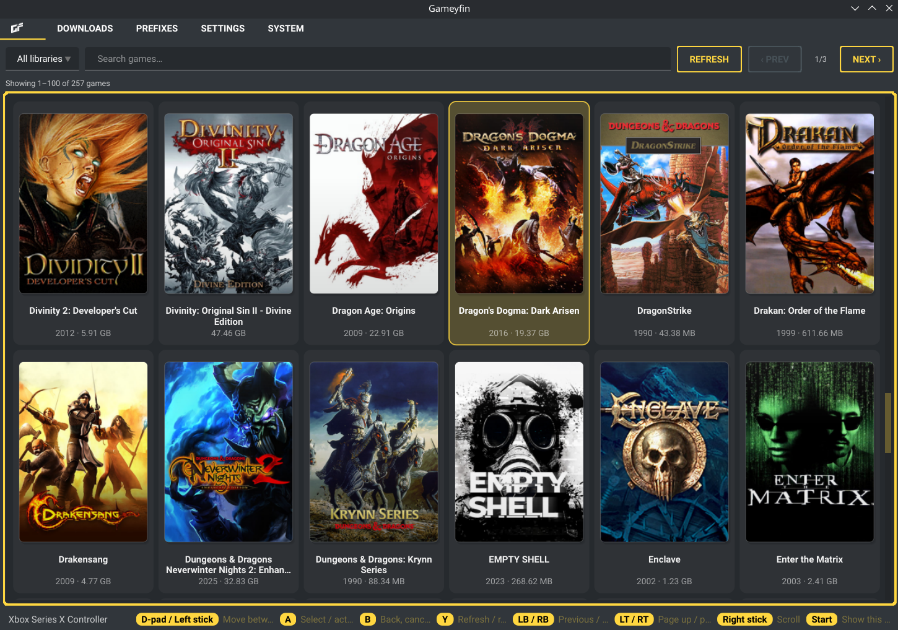
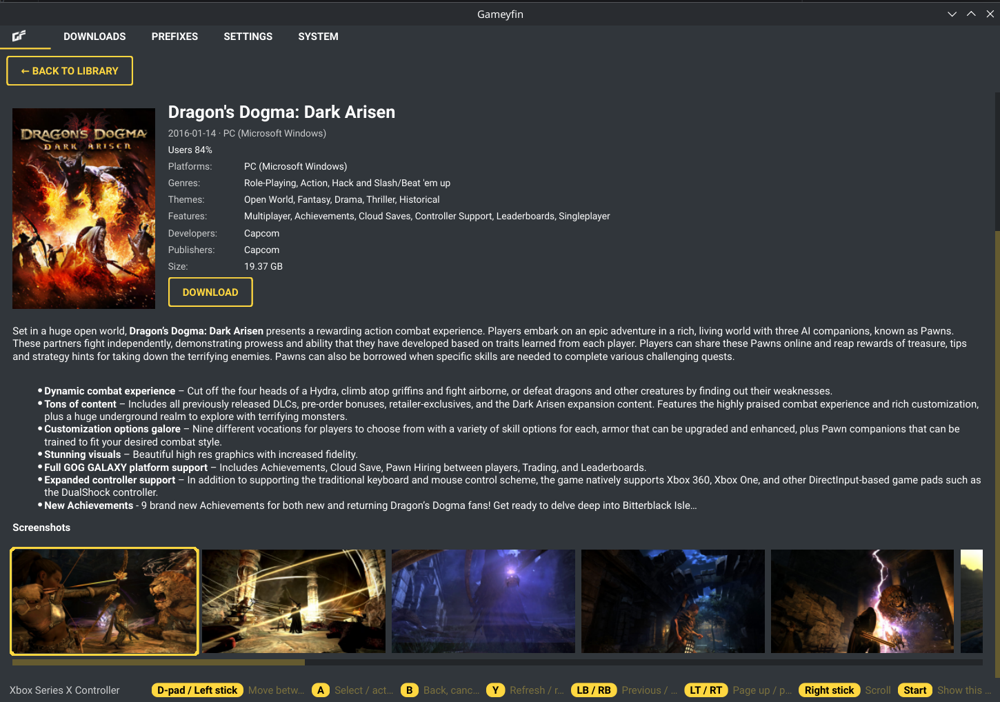
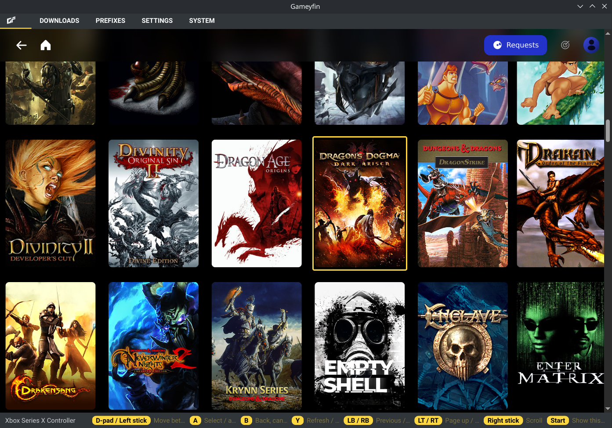
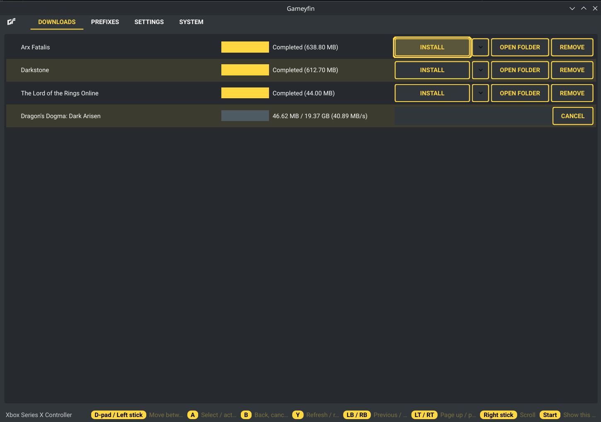
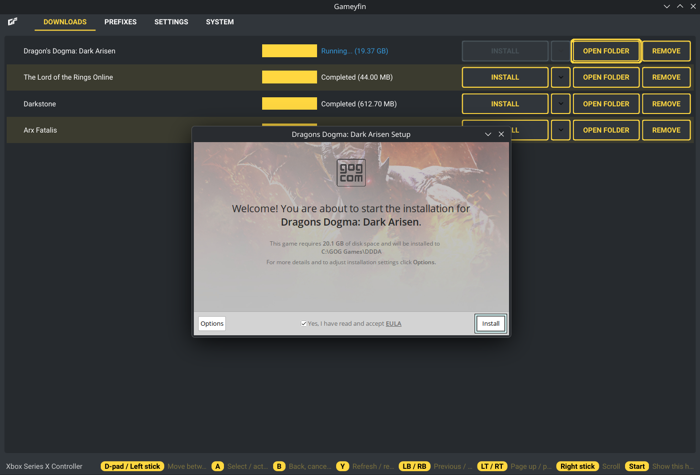
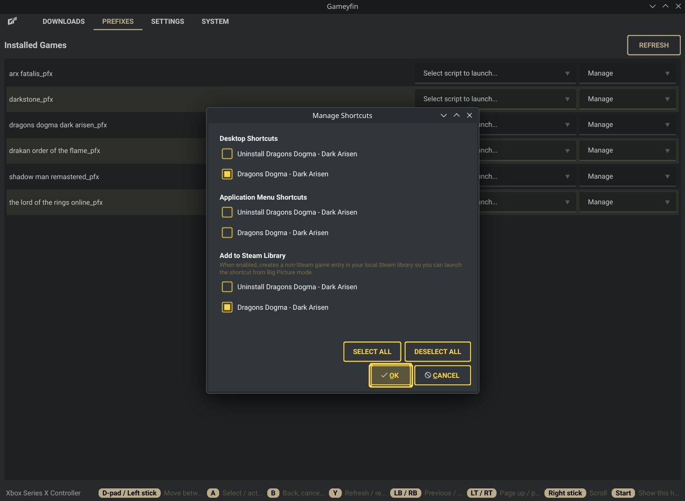
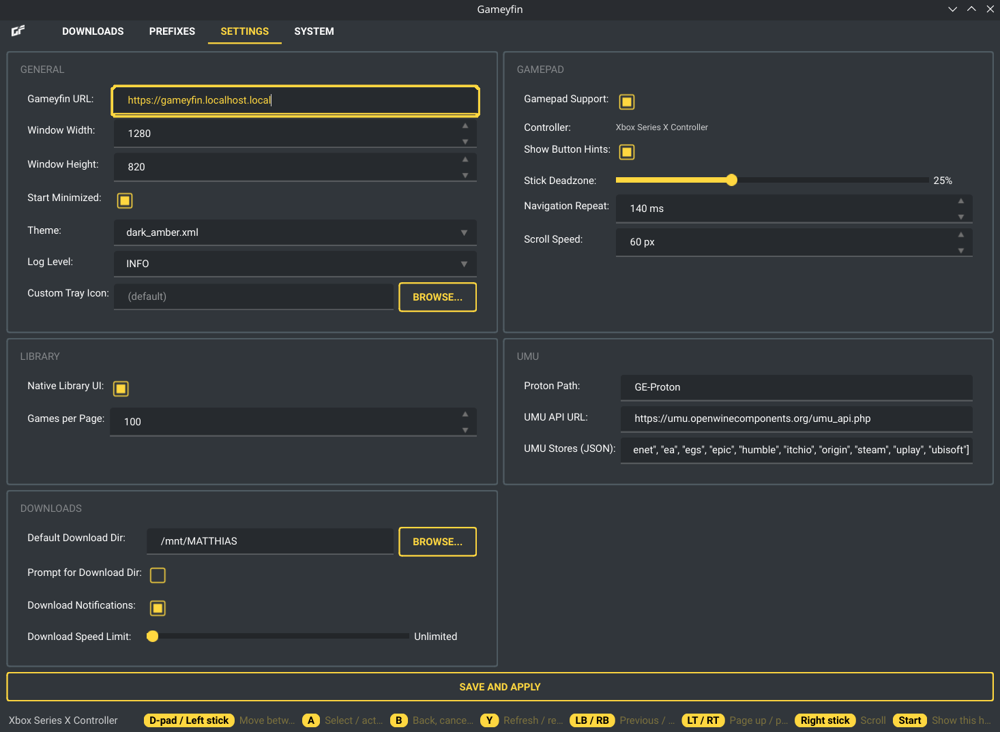
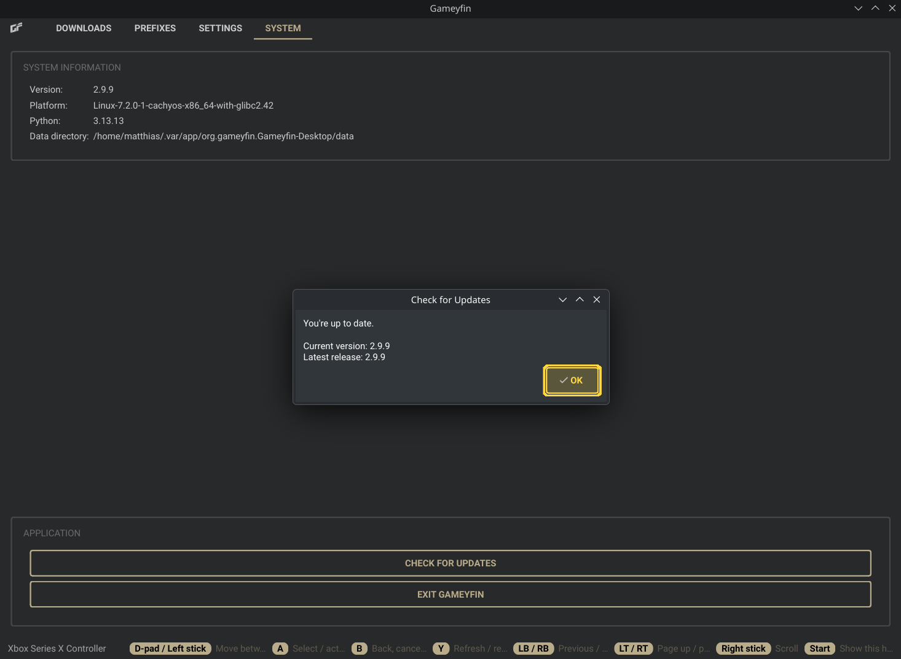
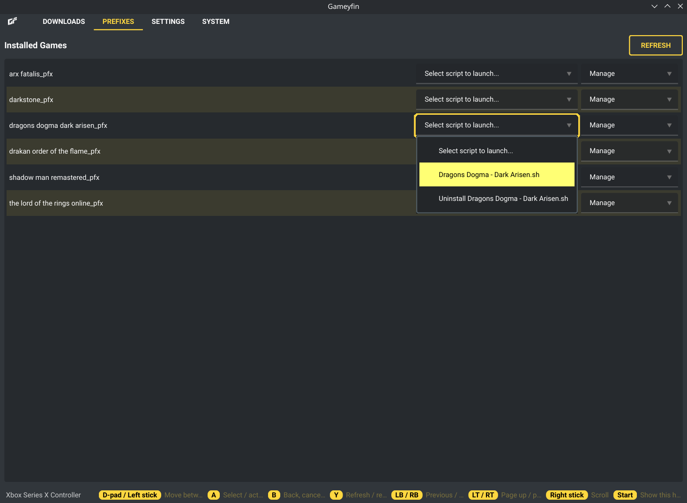
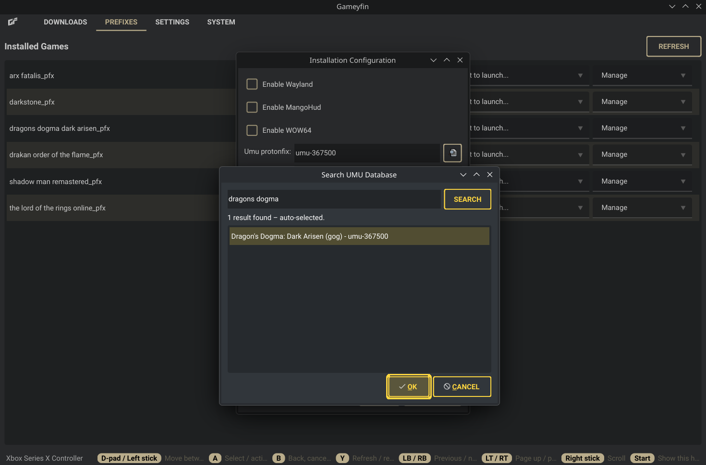

